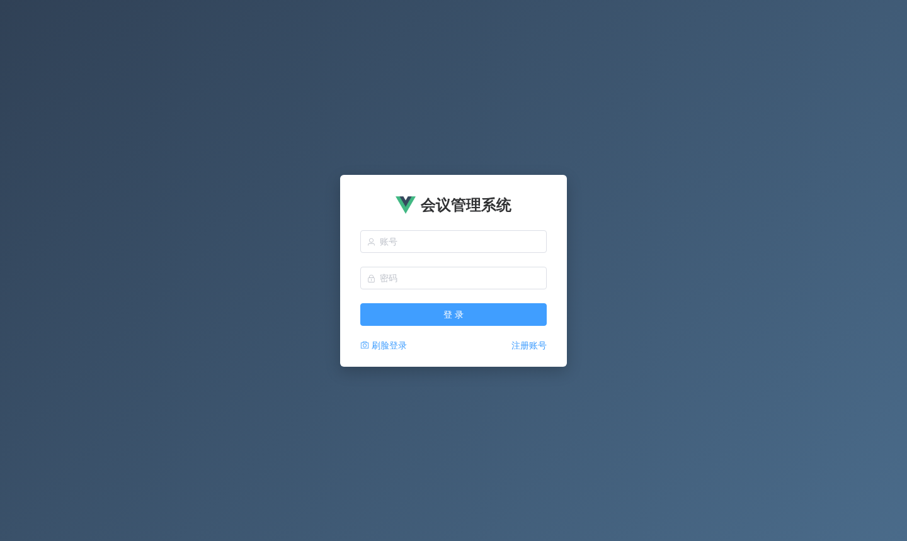
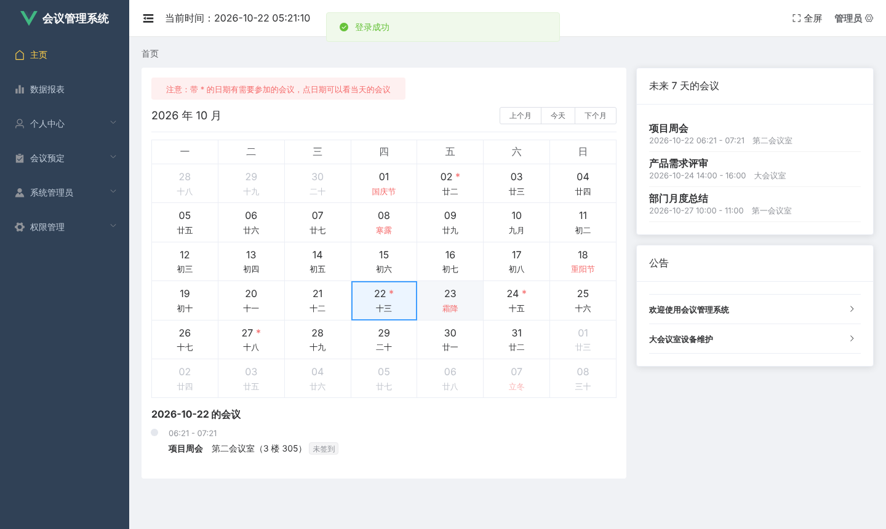
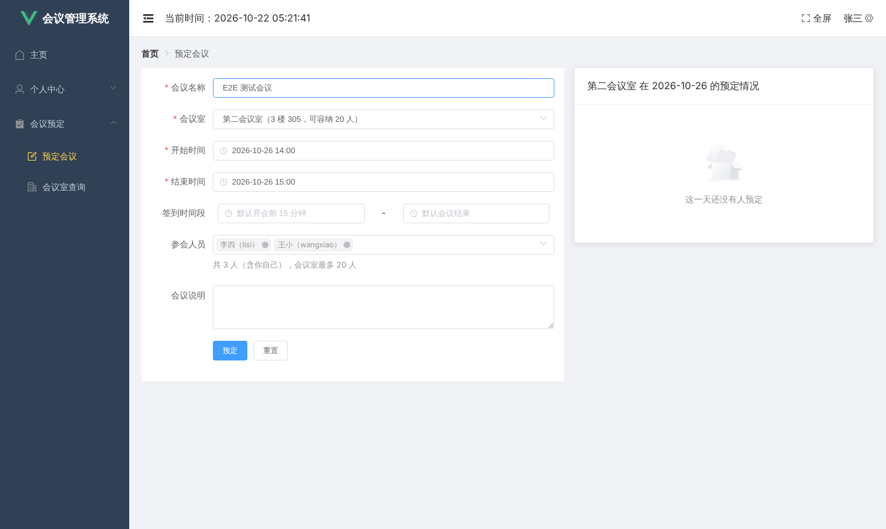
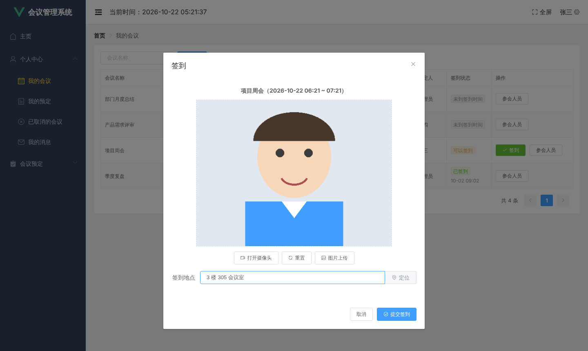
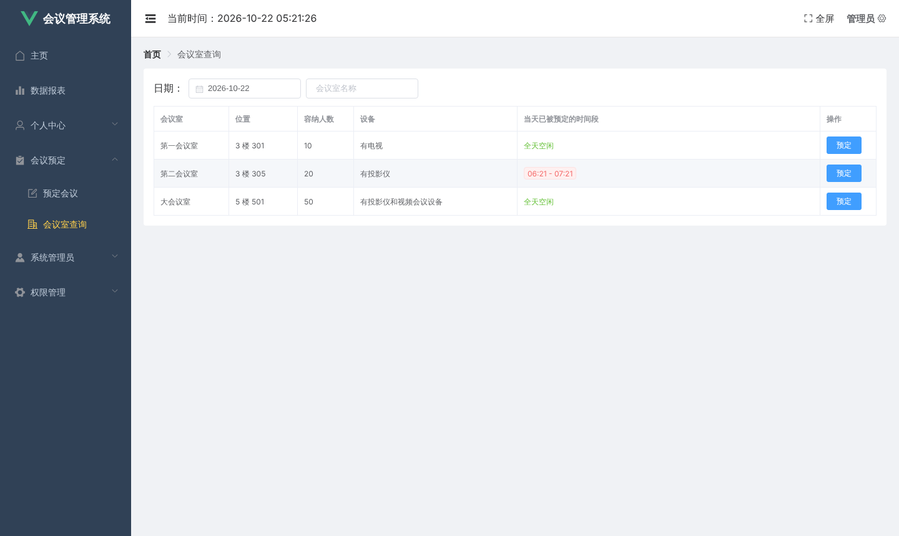
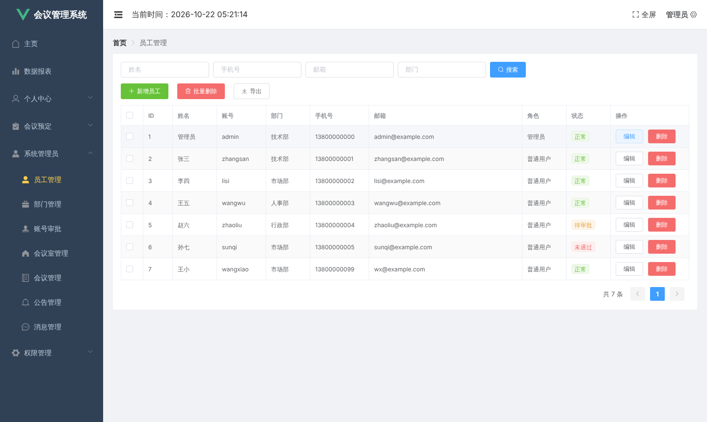

# 会议管理系统（人脸登录 / 人脸签到）

企业内部的会议管理系统：员工预定会议室，参会人拍照签到，管理员审批账号、管理会议室和权限。人脸识别调用的是百度智能云的接口，没有密钥时可以用演示模式跑通全部流程。

仓库名叫 Access-control-system，但实际内容是这个会议系统。

> 原仓库的代码不完整（缺前端页面、后端配置、建表 SQL 和会议模块），2026-10 按剩下的代码和原截图把缺的部分重建了，现在可以完整运行。重建的部分和原作者的实现不一定一样，详见[重建说明](#重建说明)。

| 登录 | 首页：会议日历 |
| --- | --- |
|  |  |
| **预定会议** | **签到** |
|  |  |
| **会议室查询** | **数据报表** |
|  |  |
| **员工管理** | **系统架构** |
|  |  |

## 功能

**普通用户**

- 账号密码登录、刷脸登录、注册（注册后要管理员审批）、修改密码
- 首页：会议日历（农历、节日，标出有会议的日期）、未来 7 天的会议、公告
- 预定会议：选会议室、时间和参会人；会检查时间冲突、会议室容量、会议室是否停用，右侧显示会议室当天已被预定的时间段
- 会议室查询：按日期看每个会议室哪些时间段被占用，可以直接点"预定"
- 我的会议：在签到时间内拍照（或上传照片）签到，可以用浏览器定位填签到地点
- 我的预定：查看参会人员和签到情况、导出签到表（Excel）、取消会议
- 已取消的会议、我的消息、个人信息（录入人脸照片）

**管理员**（另外多出这些菜单）

- 数据报表、员工管理（含导出 Excel）、部门管理、账号审批
- 会议室管理（可以停用）、会议管理（可以取消任何人的会议）
- 公告管理、消息管理（可以指定接收人）
- 角色管理（给角色分配菜单）、菜单管理

菜单是按角色从数据库读出来的，登录后前端按菜单动态生成路由。

## 技术栈

| 部分 | 用到的东西 |
| --- | --- |
| 前端 `meeting/` | Vue 2、Vue Router、Vuex、Element UI、ECharts、axios、dayjs |
| 后端 `RookieMeeting/` | Spring Boot 2.5、MyBatis-Plus 3.5、Druid、Redis、JWT、EasyPOI、Knife4j |
| 人脸识别 | 百度智能云人脸识别 Java SDK（可选） |
| 数据库 | MySQL 5.7 / 8.0 |

## 运行

需要：JDK 8 以上、Maven 3.6 以上、MySQL、Redis、Node.js 16 以上。

2026-10 实测环境：JDK 21、Maven 3.9、MySQL 8.0.46、Redis 7、Node.js 22，Chromium 浏览器。

### 1. 建数据库

```
mysql -uroot -p -e "CREATE DATABASE rookismeeting DEFAULT CHARSET utf8mb4;"
mysql -uroot -p rookismeeting < sql/rookismeeting.sql
```

示例数据里的会议时间按导入当天生成，导入后马上就有"今天能签到"和"未来几天"的会议。想重置数据，重新执行上面两条命令即可。

### 2. 启动后端

默认配置（`RookieMeeting/src/main/resources/application.yml`）连的是本机 MySQL（账号 `root`，密码 `root`）和本机 Redis（无密码），端口 8888。
和你的环境不一样的话，不要直接改这个文件：把同目录的 `application-local.example.yml` 复制成 `application-local.yml`，只写要改的项。`application-local.yml` 已加入 `.gitignore`，密码和密钥不会被提交。

```
cd RookieMeeting
mvn spring-boot:run
```

日志里出现 `Started RookieMeetingApplication` 就启动好了。接口文档在 http://localhost:8888/doc.html 。

### 3. 启动前端

```
cd meeting
npm install
npm run serve
```

打开 http://localhost:8080 。后端不在 `http://localhost:8888` 时，在 `meeting/` 下新建 `.env.local`，写一行 `VUE_APP_API_BASE=后端地址`。

### 示例账号

密码都是 `123456`。

| 账号 | 角色 | 说明 |
| --- | --- | --- |
| admin | 管理员 | 能看到全部菜单 |
| zhangsan | 普通用户 | 是"项目周会"的预定人，导入后就能签到 |
| lisi、wangwu | 普通用户 | |
| zhaoliu | 普通用户 | 待审批，登录会被拒绝，可以用 admin 在"账号审批"里通过 |
| sunqi | 普通用户 | 审批未通过 |

管理员在"员工管理"里新增的员工，初始密码是 `111111`。

## 人脸识别（可选）

默认是**演示模式**（`baidu.enabled: false`）：

- 个人信息里可以录入人脸照片，只保存在本地 `RookieMeeting/data/faces/`
- 签到不比对人脸，照片可以不传，在签到时间内点"提交签到"就算签到成功
- 刷脸登录不可用，会提示用账号密码登录

要真正用人脸识别：

1. 在[百度智能云](https://console.bce.baidu.com/ai/#/ai/face/overview/index)开通人脸识别，创建应用，在人脸库里建一个名为 `employee` 的用户组。
2. 在 `application-local.yml` 里填 `baidu.appId`、`baidu.key`、`baidu.secret`，把 `baidu.enabled` 改成 `true`。
3. 每个员工到"个人信息"重新保存一次人脸照片，照片才会注册到百度人脸库（用户 ID 就是员工 ID）。

注意：

- 这部分我没有百度的密钥，**没有实测过真实识别**，代码是按百度 SDK 的接口写的。演示模式下的流程都实测过。
- 浏览器只在 `localhost` 或 `https` 页面允许打开摄像头。用局域网 IP 访问时摄像头打不开，可以用"图片上传"。
- 签到地点用浏览器定位，得到的是经纬度。在 `meeting/.env.local` 里配置 `VUE_APP_BAIDU_MAP_AK=你的百度地图AK` 后会换成文字地址。

## 部署

- 后端：`cd RookieMeeting && mvn -DskipTests package`，然后 `java -jar target/RookieMeeting-0.0.1-SNAPSHOT.jar`。`application-local.yml` 可以放在启动目录下；照片目录 `data/` 也在启动目录下。
- 前端：`cd meeting && npm run build`，把 `dist/` 交给 Nginx。路由是 history 模式，Nginx 要加 `try_files $uri $uri/ /index.html;`，否则刷新页面会 404。
- 前端打包时会把后端地址写死进去，部署前先在 `.env.local` 里设好 `VUE_APP_API_BASE`。

## 重建说明

原仓库缺的部分和这次补的内容：

| 原来缺的 | 现在 |
| --- | --- |
| 前端 `App.vue`、`components/`、`views/`（所有页面） | 按原截图的样式重写了全部页面；`router/`、`store/`、`util/request.js`、`util/calendar.js` 是原来的，有修改 |
| 后端 `application.yml` | 新写了一份能直接启动的默认配置，外加 `application-local.example.yml` 模板 |
| 建表 SQL | `sql/rookismeeting.sql`，表结构按实体类和 Mapper 反推，附示例数据 |
| 会议模块（会议、会议室、参会记录） | 新写了实体、Mapper、Service 和 `MeetingController`、`MeetingRoomController`；被注释掉的报表、通知、签到代码已恢复 |

顺手修掉的原有问题：

- 普通用户可以通过"个人信息保存"接口把自己的角色改成管理员；现在这个接口只能改姓名、手机、邮箱、部门。
- 登录接口和员工列表接口会把密码哈希返回给前端。
- 改密码、审批账号之后，Redis 缓存没有清，旧密码还能登录、审批结果不生效（XML 里的 SQL 没有用接口上的同一个缓存）。
- 注册时手机号和邮箱没有存进数据库。
- 公告管理接口复制粘贴写错，实际操作的是消息表。
- 签到成功的提示是"恭喜您支付成功"。
- 照片用相对路径保存，实际存进了 Tomcat 的临时目录；照片下载接口可以用 `../` 读服务器上的任意文件。
- 后端启动时会清空所连 Redis 库里的**所有**键，现在只清本系统的缓存。
- 时间：没有配置时 Jackson 按 UTC 输出时间，页面会和数据库差几个小时；现在统一按本机时区。
- 前端路由守卫重复调用 `next()`，动态路由的判断条件写错了名字。

## 已知问题

- **后端只校验是否登录，不校验角色。** 普通用户的侧边栏里没有管理菜单，但如果直接调管理接口（比如删除员工）不会被拦截。要给别人用之前需要补上权限校验。
- 密码是 MD5 加固定盐，强度不够。
- `config/DruidConfig.java` 里 Druid 监控页的登录密码写死为 `123456`，上线前要改。
- `CodeGenerator.java` 里写着本地数据库账号和 Windows 路径，只在开发时生成代码用。
- 依赖是 2021 年前后的版本（如 fastjson 1.2.76、Spring Boot 2.5.6），有已知的安全漏洞，不建议直接部署到公网。
- Maven Wrapper 不完整（只有 `mvnw.cmd` 和 jar，没有 `mvnw`），请用本机装的 Maven。
- 旧版 `meeting/public/index.html` 里的百度地图 AK 还留在 git 历史里，建议到百度控制台作废或设置域名白名单。

## 目录结构

```
├── docs/screenshots/                README 用的截图和架构图
├── sql/rookismeeting.sql            建表语句和示例数据
├── meeting/                         前端（Vue 2）
│   ├── .env                         前端环境变量默认值（后端地址、百度地图 AK）
│   └── src
│       ├── components/              布局、拍照组件、参会人员弹窗
│       ├── views/                   页面，路径和数据库 sys_menu 表的 page_path 对应
│       ├── router/index.js          路由，菜单页面是登录后按角色动态加载的
│       └── util/                    axios 封装、登录信息、农历计算、管理页通用逻辑
└── RookieMeeting/                   后端（Spring Boot）
    └── src/main
        ├── java/com/rookie/rookiemeeting
        │   ├── controller/          接口
        │   ├── service/  mapper/  entity/  dto/
        │   ├── config/              Druid、Redis、跨域、JSON、Swagger、百度人脸 SDK 等配置
        │   ├── interceptor/         JWT 登录校验
        │   └── util/
        └── resources
            ├── application.yml                  默认配置
            ├── application-local.example.yml    本机配置模板
            └── mapper/                          MyBatis 的 SQL
```
