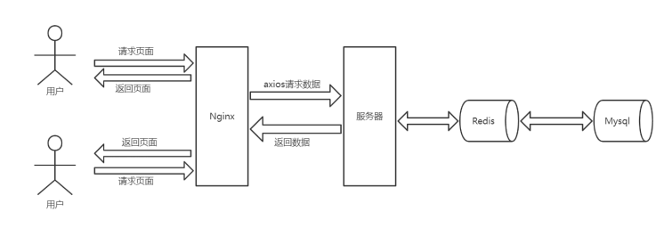
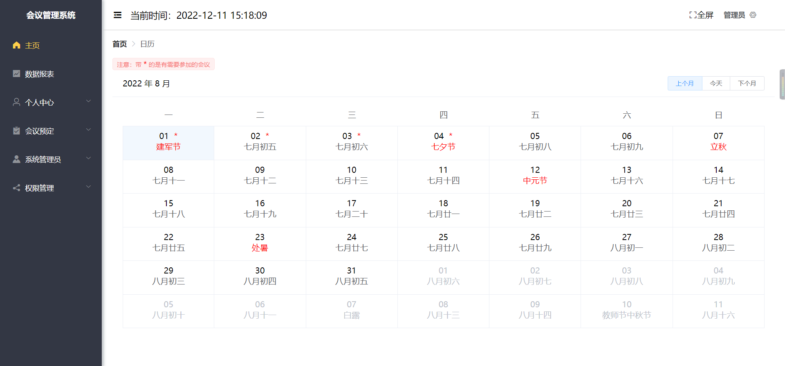
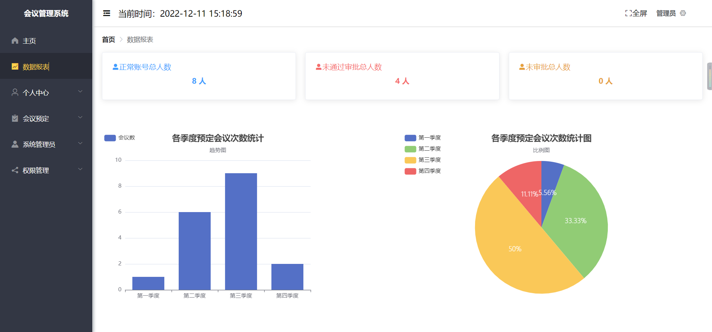
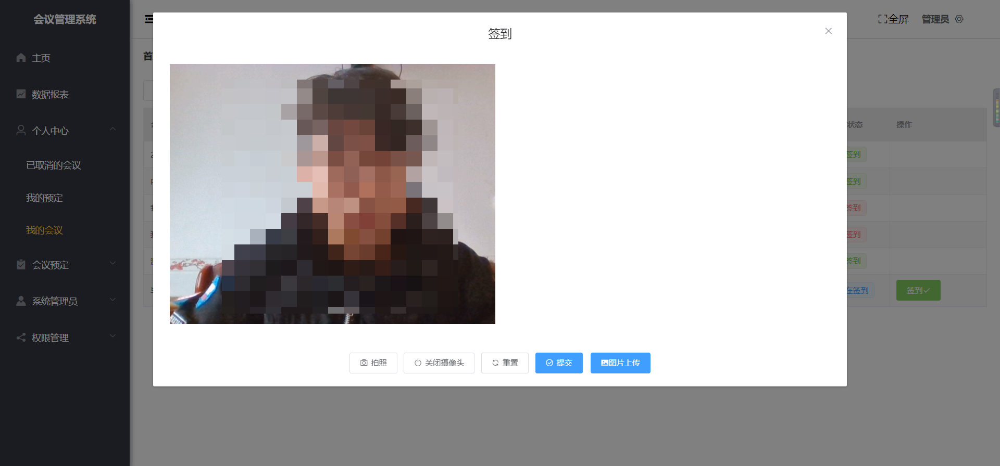
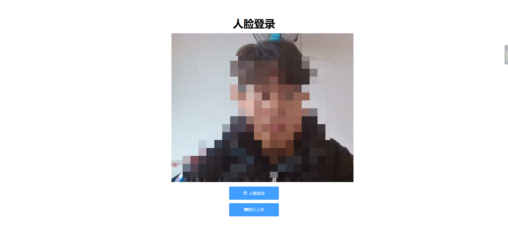

# 会议管理系统（人脸登录 / 人脸签到）

企业内部的会议管理系统：员工预定会议，参会人用摄像头刷脸签到，也可以刷脸登录。人脸识别调用的是百度智能云的接口。
仓库名叫 Access-control-system，前端页面标题写的是"门禁管理系统"，但从界面截图和代码来看，实际做的是这个会议系统。

> **代码不完整，目前无法直接运行。** 前端页面、后端配置文件和建表 SQL 都不在仓库里，详见下面的[代码现状](#代码现状)。



| 会议日历 | 数据报表 |
| --- | --- |
|  |  |
| **人脸签到** | **人脸登录** |
|  |  |

截图来自项目完整时的运行效果，人脸已打码。

## 功能

| 功能 | 现在仓库里有没有对应代码 |
| --- | --- |
| 账号密码登录、注册、修改密码 | 后端有（`EmployeeController`），前端页面缺失 |
| 人脸登录、注册时录入人脸、会议人脸签到 | 后端有（`PhotoController`，调用百度人脸识别），前端页面缺失 |
| 新注册账号由管理员审批 | 后端有（`ApproveAccountController`） |
| 数据报表（账号审批人数、各季度会议数） | 账号部分有；会议统计部分的代码被注释掉了 |
| 会议日历（农历、节日） | 前端只剩 `src/util/calendar.js` |
| 会议预定、我的预定、我的会议、取消会议 | 后端会议模块的代码不在仓库里（相关调用被注释掉了） |
| 参会人员和考勤导出 Excel | 后端有（`ChangeBookingController`），依赖会议相关的数据表 |
| 员工、部门、角色、菜单权限、公告、消息管理 | 后端有 |

## 技术栈

| 部分 | 用到的东西 |
| --- | --- |
| 前端 `meeting/` | Vue 2、Vue Router、Vuex、Element UI、ECharts、axios |
| 后端 `RookieMeeting/` | Spring Boot 2.5、MyBatis-Plus 3.5、Druid、Redis、JWT、EasyPOI、Knife4j |
| 人脸识别 | 百度智能云人脸识别 Java SDK |
| 数据库 | MySQL |

## 代码现状

和截图里能跑的版本相比，仓库里少了这些：

| 缺什么 | 影响 |
| --- | --- |
| 前端 `src/App.vue`、`src/views/`、`src/components/` | 前端所有页面都没有，`npm run build` 会失败 |
| 后端 `src/main/resources/application.yml` | 后端启动不了；按代码整理了一份模板 `application-example.yml` |
| 建表 SQL | 数据库没法建；从代码看至少需要 `employee`、`department`、`sys_role`、`sys_menu`、`sys_role_menu`、`sys_dict`、`news`、`message`，以及会议和参会记录相关的表 |
| 后端会议模块（会议、会议室的实体、Service、Controller） | `EChartsController`、`NotificationsController` 里调用它们的代码被注释掉了；`MeetingDto`、`RoomDto` 等 DTO 还在但没人用 |
| Maven Wrapper 的 `mvnw` 和 `maven-wrapper.properties` | 只剩 `mvnw.cmd` 和 jar，用不了，请直接用本机装的 Maven |

现在能做的验证：后端在 JDK 21 + Maven 3 下 `mvn compile` 可以通过（2026-10 实测），但因为缺配置和数据库，启动不了。

## 补全后怎么运行

如果把缺的文件补回来，运行步骤大致是这样：

**后端**

1. 准备 MySQL 和 Redis，建好数据库（代码生成器里用的库名是 `rookismeeting`）。
2. 把 `RookieMeeting/src/main/resources/application-example.yml` 复制成 `application.yml`，填上数据库、Redis、百度人脸识别的 AppID / API Key / Secret Key，以及两个照片目录。`application.yml` 已经加进 `.gitignore`，不会被提交。
3. 在 `RookieMeeting/` 目录运行 `mvn spring-boot:run`，默认端口 8888（前端写死了这个地址，在 `meeting/src/util/request.js`）。

注意：后端启动时会清空所连 Redis 里的**所有** key（`MyApplicationRunner`），不要连到和别的程序共用的 Redis。

**前端**

1. 如果要用地图，在 `meeting/` 下新建 `.env.local`，写一行 `VUE_APP_BAIDU_MAP_AK=你的百度地图AK`（模板见 `meeting/.env`，`.env.local` 不会被提交）。不写的话地图用不了，其他功能不受影响。
2. 在 `meeting/` 目录运行：

   ```
   npm install
   npm run serve
   ```

## 目录结构

```
├── docs/screenshots/                README 用的架构图和截图
├── meeting/                         前端（Vue 2，页面文件缺失）
│   ├── public/index.html
│   ├── .env                         前端环境变量默认值（百度地图 AK 留空）
│   └── src
│       ├── main.js
│       ├── router/index.js          路由，菜单页面是登录后按权限动态加载的
│       ├── store/index.js
│       ├── util/request.js          axios 封装，后端地址在这里
│       └── util/calendar.js         农历和节日计算
└── RookieMeeting/                   后端（Spring Boot）
    ├── pom.xml
    └── src/main
        ├── java/com/rookie/rookiemeeting
        │   ├── controller/          接口
        │   ├── service/  mapper/  entity/  dto/
        │   ├── config/              Druid、Redis、跨域、Swagger、百度人脸 SDK 等配置
        │   ├── interceptor/         JWT 登录校验
        │   └── util/
        └── resources
            ├── application-example.yml   配置模板
            └── mapper/              MyBatis 的 SQL
```

## 已知问题

- `config/DruidConfig.java` 里 Druid 监控页的登录密码写死为 `123456`，上线前要改。
- `CodeGenerator.java` 里写着本地数据库账号 `root` / `root` 和 Windows 路径，只在开发时生成代码用。
- 依赖是 2021 年前后的版本（如 fastjson 1.2.76、Spring Boot 2.5.6），有已知的安全漏洞，不建议直接部署到公网。
